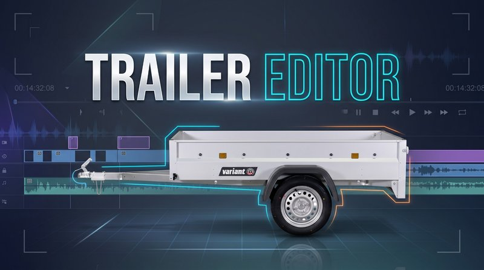
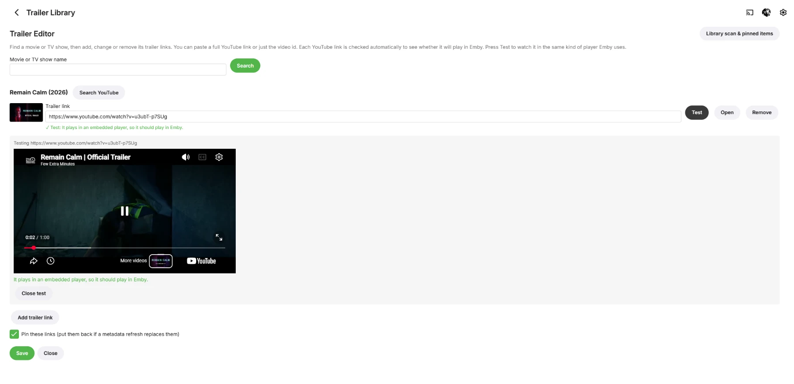
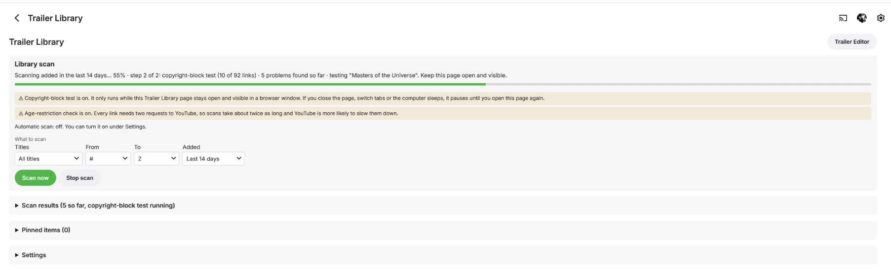
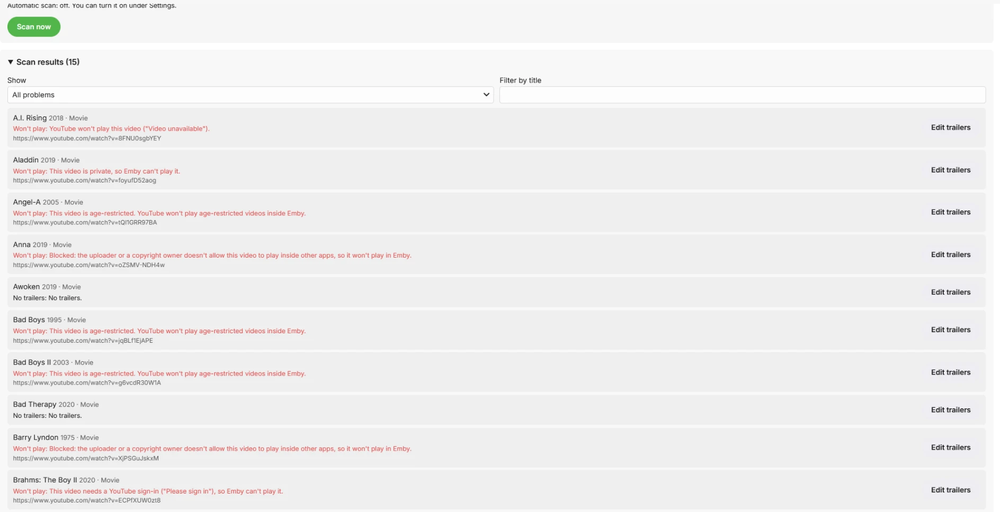

# Trailer Editor for Emby



[](https://github.com/PeterDBNL/emby-trailer-editor/releases/latest)
[](https://github.com/PeterDBNL/emby-trailer-editor/actions/workflows/build.yml)

An Emby Server plugin that lets you fix the **trailer links** of your movies and TV shows, for
example to swap a wrong or dead YouTube trailer for the right one, and finds the broken ones for you.

### [Download the latest version](https://github.com/PeterDBNL/emby-trailer-editor/releases/latest/download/TrailerEditor.zip)

All versions: [Releases](https://github.com/PeterDBNL/emby-trailer-editor/releases). See [Install](#install) below.

## Features

- Add, change or remove the trailer links of any movie or TV show. Emby's own metadata editor can't do this.
- Paste any YouTube link (`youtube.com/watch?v=...`, `youtu.be/...`, `/embed/...`, `/shorts/...`)
  or just the 11-character video id. It is saved as a standard `https://www.youtube.com/watch?v=ID` link.
- Every link is checked automatically to see whether it will really play in Emby. The **Test**
  button plays it in a visible player, and **Search YouTube** finds a replacement quickly.
- **Pin** your links so a metadata refresh (e.g. "Replace all metadata") can't overwrite them.
- **Library scan** for titles without trailers and for trailer links that are broken or won't play.
  Scan everything, a part of the library (movies or TV shows, a range of letters) or only recently
  added titles, now or on a daily or weekly schedule.
- Optional copyright-block test in your browser, which catches videos the server can't judge.
- Learns from trailers that play in Emby, so fewer links need testing.
- **Find trailer** picks the best trailer for you (YouTube search, optionally TMDb's official list),
  and **Delete trailers** removes them for good. Both work from the web player, the desktop app and
  the mobile apps through two special collections, and from the Trailer Editor page.
- Deleted trailers are remembered per title and never picked or restored again.

## Screenshots

**Trailer Editor**: edit a title's trailer links. Each link is checked automatically, and
*Test* plays it in the same kind of player Emby uses. *Search YouTube* helps find a new one.



**Trailer Library**: scan the whole library, or part of it (type, title range, recently
added), with live progress for both steps.



**Scan results**: every problem found, with the reason, and an *Edit trailers* button to fix it.



## Requirements

Emby Server **4.8 or newer** (tested on 4.10.2 in Docker).

## Install

1. [Download `TrailerEditor.zip`](https://github.com/PeterDBNL/emby-trailer-editor/releases/latest/download/TrailerEditor.zip)
   and unzip it.
2. Copy `TrailerEditor.dll` into Emby's `plugins` folder:
   - Docker: `/config/plugins` inside the container
   - Linux: `/var/lib/emby/plugins`
   - Windows: `%AppData%\Emby-Server\programdata\plugins`
   - Synology/other NAS: the `plugins` folder inside Emby's data folder
3. On Linux and Docker, give the file the same owner as the other plugins in that folder
   (for example `chown --reference=<another plugin>.dll TrailerEditor.dll`).
4. Restart Emby Server.
5. Open **Plugins** in the Emby dashboard and check that *Trailer Editor* is listed.

To update, repeat the same steps with the new download and replace the old file.

## Using it

### Trailer Editor

1. Open the Emby dashboard (as an administrator).
2. Click **Trailer Editor** in the side menu (also under *Plugins*).
3. Search for a title, click it, edit the links and click **Save**.

Each link shows a YouTube thumbnail and an **Open** button. Leave every link box empty and
save to remove all trailers from the item.

**Will it play?** Emby plays YouTube trailers in YouTube's embedded player, and YouTube refuses
some videos there ("No compatible streams are currently available"). Each link is checked as
soon as it is shown or pasted:

1. *Server check*: your Emby server asks YouTube about the video. This catches embedding turned
   off, age-restricted, private and deleted videos.
2. *Playback test*: the page plays the video muted for a moment in a tiny hidden player, like
   the one Emby uses. This also catches videos a **copyright owner blocks in other apps**, which
   the server can't see.

The result shows under the link: **it plays**, **won't play** (with the reason) or **couldn't
check** (YouTube didn't answer, or it isn't a YouTube link). Links are tested one at a time and
results are remembered for an hour. Saving a link that won't play asks for confirmation first.

**Pinning.** Emby has no way to lock trailer links, so a full metadata refresh can replace your
edits with what the metadata provider returns. With **Pin these links** ticked on save (the
default), the plugin remembers your links and puts them back if a refresh changes them.
**Unpin** keeps the current links but stops protecting them. If you change a pinned item's
trailers some other way, the next refresh puts the pinned links back, so unpin first if you
don't want that.

### Find and delete trailers (also from the Emby apps)

**From the Emby apps.** Emby apps don't let plugins add menu entries, but every app (web player,
desktop app, mobile apps) can add a title to a collection. The plugin therefore keeps two
collections, created automatically a short while after the server starts:

- **Trailer Editor: Find trailer**
- **Trailer Editor: Delete trailer**

On a movie or TV show open the **⋯** menu, choose **Add to collection** and pick one of them.
The title is taken out of the collection again right away and the action runs in the background
(titles are handled one at a time). On a season or episode the action applies to its TV show.
See **Recent trailer actions** on the Trailer Library page for what happened.

**Find trailer** looks for the best trailer and puts it first in the title's links (pinned). The
title's other working links are kept (at most 3 links in total). The search:

1. Collects candidates from YouTube's search page for "title year trailer" (also with the original
   title, if different), and, if you set a TMDb API key, from TMDb's trailer list for the title.
2. Drops videos that were deleted from this title, and videos known not to play in Emby.
3. Scores the rest: how well the video title matches (and the year), "official trailer", TMDb's
   *official* flag and language, verified channels, a sensible length and view count, and heavy
   penalties for reactions, reviews, fan-made or concept trailers, full movies, "explained",
   clips, behind the scenes, soundtracks and similar. Weak matches are not used.
4. Checks the best ones with YouTube, in order, and takes the first that will play in Emby.

On the Trailer Editor page, **Find trailer** shows the best candidates (thumbnail, channel,
length, score and why) without changing anything. **Use this** puts one first in the link list,
**Use best & save** saves the top one right away.

**Delete trailers** removes all links of a title and unpins it.

**Rejected links.** Every deleted link, and every link you remove in the editor and save, is
remembered for that title. Find trailer never picks it again, and if a metadata refresh brings it
back it is taken off again. Open *Rejected links* in the editor to see them and press
**Allow again**. Saving a rejected link in the editor also allows it again.

**TMDb (optional).** Find trailer needs no keys. A free API key from
[themoviedb.org](https://www.themoviedb.org/settings/api) (*Trailer Library → Settings → TMDb API
key*) adds TMDb's list of official trailers, in your server's metadata language, which helps pick
the official one.

**Good to know.** The YouTube search reads YouTube's public search page; it is unofficial and
may stop working if YouTube changes it. Copyright blocks can't be detected on the server, so a
pick may occasionally be blocked in some countries: delete it and find again, it won't be picked
twice. Anyone who can edit collections in Emby can trigger these actions. Turn the collections
off under *Trailer Library → Settings → Trailer search & app actions*.

### Trailer Library

Open it from the side menu, or with the *Library scan & pinned items* button on the Trailer
Editor page.

**Library scan.** Goes through your movies and TV shows and reports:

- *Won't play*: YouTube links that are deleted, private, have embedding turned off or
  (optionally) are age-restricted
- *No trailers*: titles without trailer links (optionally ignoring titles that have local trailer files)
- *Invalid link* and *Duplicate link*

Press **Scan now**, or turn on an automatic daily or weekly scan under *Settings* (off by
default). Progress shows on the page and in Scheduled Tasks. Click the summary buttons to filter
the results and **Edit trailers** on a title to fix it. Saving a title in the editor removes its
results until the next scan.

**Scanning part of the library.** Above *Scan now*, choose *All titles*, *Movies* or *TV shows*
and a range of first letters (*From* and *To*; `#` is every title that doesn't start with A-Z).
Only that part is scanned and only its results are replaced; a finished scan of a segment also
drops titles that are no longer in it. A scan you stop only replaces the titles it reached.

**Recently added titles.** The *Added* choice limits a scan to titles added in the last day, 3,
7, 14, 30, 90 or 365 days, or a custom number of days (1-3650). Such a scan never removes
results of titles it didn't scan. Under *Settings*, *Automatic scans cover* chooses whether
scheduled scans check the whole library (the default) or only recently added titles.

**Stop scan** stops everything, including the copyright-block test. If that test was
interrupted, the page shows how many links were tested and a **Continue copyright-block test**
button; starting a new scan clears the stop.

**Scan results**, **Pinned items**, **Recent trailer actions** (the last 200 finds and deletes,
newest first) and **Settings** are collapsible sections. The lists load
when opened, are searchable by title and paged 50 at a time, so they stay fast with tens of
thousands of titles.

**Age restrictions (on by default).** Detecting age-restricted videos needs a second request to
YouTube for every link, so scans take about twice as long. Turn it off under Settings if scans
are too slow.

**Large libraries.** The scan pauses between YouTube requests (1 second by default, about 3,600
links an hour) so YouTube doesn't block your server. A link's result is reused for 30 days, so
after the first full scan, weekly scans only check new and older links. If YouTube starts
refusing requests, the scan slows down, and after 25 failures in a row it stops checking links
for that run and says so. The pause and the re-check days can be changed under *Settings*.

**Copyright blocks (on by default, needs an open browser).** Only a browser can detect that a
video is blocked by its copyright owner. With *Test playback in this browser to catch copyright
blocks* ticked under Settings, the Trailer Library page plays each scanned link muted in a hidden
YouTube player. **This only runs while the Trailer Library page stays open and visible in a
browser window.** If you close it, switch tabs or the computer sleeps, testing pauses and
continues next time you open the page. With this test on, the scan counts as finished only
after the test is done; the progress bar covers both steps. Blocked links appear as *Won't
play*. Links that already failed the server check, or were tested within the re-check period,
are skipped. The test covers only the part of the library that was scanned.

**Fewer tests needed.** Playback results are shared: every link tested on the Trailer Editor
page counts, and with *Learn from trailers played in Emby* on (the default), a YouTube trailer
that Emby reports as playing is marked as working. Failed trailers never reach the server, so
this only finds working links. Each reported play is written to the Emby log as
`Trailer Editor: trailer playback reported`.

## HTTP API

All endpoints need an administrator's API key or access token.

| Method | Path | What it does |
| --- | --- | --- |
| GET | `/emby/TrailerEditor/Search?SearchTerm=name&Limit=30` | Find movies / TV shows |
| GET | `/emby/TrailerEditor/Items/{Id}` | Get an item's trailer links |
| POST | `/emby/TrailerEditor/Items/{Id}?Urls=…&Pin=true` | Replace the links. `Urls` is the links separated by spaces (URL-encoded). To remove all trailers send `Clear=true` instead of `Urls` |
| GET | `/emby/TrailerEditor/Check?Url=…` | Check whether a link will play in Emby |
| DELETE | `/emby/TrailerEditor/Items/{Id}/Pin` | Unpin an item |
| GET | `/emby/TrailerEditor/Pinned?SearchTerm=&StartIndex=0&Limit=50` | List pinned items, one page at a time |
| GET | `/emby/TrailerEditor/Scan` | Scan status and summary |
| POST | `/emby/TrailerEditor/Scan?Types=&From=&To=&AddedWithinDays=` | Start a library scan. Optional `Types` (`Movie` or `Series`, empty for both), `From` and `To` (`#` or `A`-`Z`, default `#` to `Z`) and `AddedWithinDays` (1-3650; only titles added in the last that many days) limit it to part of the library |
| POST | `/emby/TrailerEditor/Scan/Cancel` | Stop a running scan, and the copyright-block test |
| POST | `/emby/TrailerEditor/Playback/Stop` | Stop the browser copyright-block test |
| POST | `/emby/TrailerEditor/Playback/Continue` | Let the browser copyright-block test continue |
| GET | `/emby/TrailerEditor/Playback/Queue?Limit=10` | Next scanned YouTube links that need a browser playback test |
| POST | `/emby/TrailerEditor/Playback/Result?VideoId=…&Status=ok\|error\|unknown&Message=…` | Record a browser playback test result |
| GET | `/emby/TrailerEditor/Scan/Issues?Kind=&SearchTerm=&StartIndex=0&Limit=50` | Scan results, one page at a time. `Kind`: `Unplayable`, `NoTrailers`, `InvalidLink` or `DuplicateLink` |
| POST | `/emby/TrailerEditor/Items/{Id}/Find?Apply=false` | Search for the best trailer. `Apply=true` puts it first on the item (pinned); otherwise only the candidates are returned |
| POST | `/emby/TrailerEditor/Items/{Id}/DeleteTrailers` | Delete all trailer links, remember them as rejected and unpin |
| GET | `/emby/TrailerEditor/Items/{Id}/Rejected` | Links deleted or removed from the item |
| POST | `/emby/TrailerEditor/Items/{Id}/Rejected/Allow?VideoId=…` | Allow a rejected link again |
| GET | `/emby/TrailerEditor/Actions?Limit=50` | Recent find / delete actions, newest first |
| GET | `/emby/TrailerEditor/Collections` | Whether the Find / Delete trailer collections exist |

`{Id}` is the item's id as shown in Emby web URLs (`…/item?id=12345`); item Guids also work.

Example:

```sh
curl -X POST -G "http://localhost:8096/emby/TrailerEditor/Items/12345" \
  --data-urlencode "api_key=YOUR_KEY" \
  --data-urlencode "Urls=https://youtu.be/dQw4w9WgXcQ" \
  --data-urlencode "Pin=true"
```

## Building from source

Needs the .NET SDK 6 or newer.

```sh
dotnet test
dotnet build TrailerEditor/TrailerEditor.csproj -c Release
# output: TrailerEditor/bin/Release/netstandard2.0/TrailerEditor.dll
```

**Releases.** Bump the version in `TrailerEditor/TrailerEditor.csproj` and push to the default
branch. GitHub Actions builds and tests it and, if there's no release for that version yet,
publishes release `vX.Y.Z` with `TrailerEditor.zip` attached. Pushing a matching tag (e.g.
`v1.10.0` for version `1.10.0.0`) does the same. Every other build uploads the zip as a workflow
artifact.

## Notes and limitations

- Only remote (online) trailer links are edited. Local trailer files, such as
  `Movie-trailer.mkv` or a `trailers` folder next to the movie, are not affected.
- TV show trailers are set on the series, not on seasons or episodes.
- The server-side scan can't detect copyright blocks; that needs the browser test above.
- Rejected links are tracked by YouTube video id, so links to other sites can't be rejected.
- Settings added in 1.10: *Find and delete trailers from the Emby apps* (on by default) and the
  optional *TMDb API key*, both under *Trailer Library → Settings*. The plugin also saves
  `TrailerEditor.rejected.json` and `TrailerEditor.actions.json` next to its other config files.

This project is not affiliated with Emby or YouTube.
